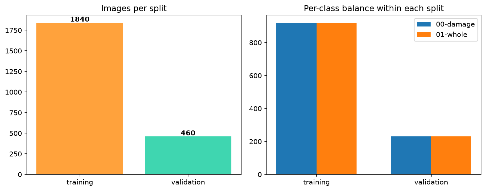
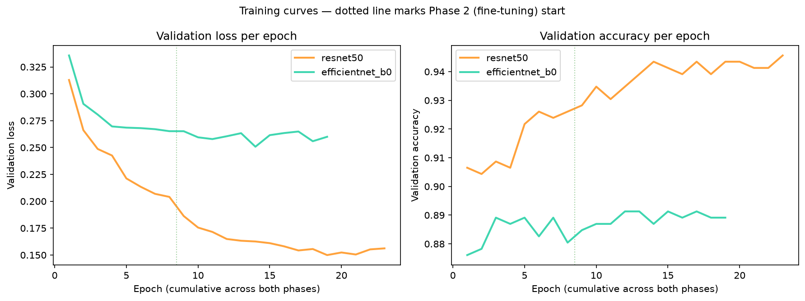
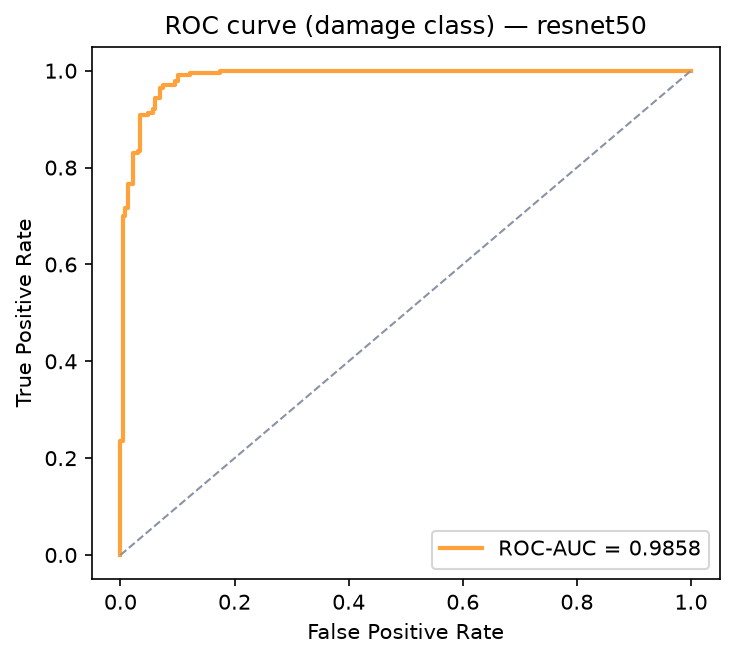
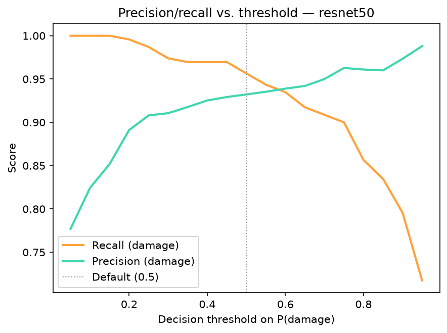
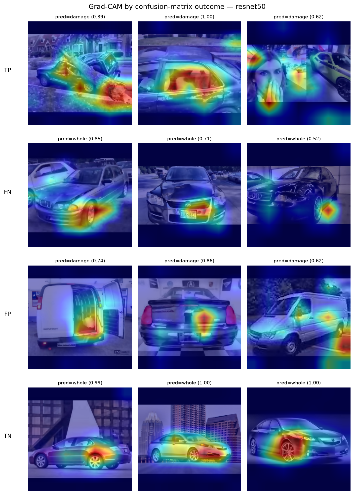

<p align="center">
  
</p>

<h1 align="center">ClaimSight</h1>
<p align="center"><b>Vehicle Damage Triage — Computer Vision + ML Pipeline Engineering</b></p>

<p align="center">
  
  
  
  
  
  
  
</p>

<p align="center">
  <a href="#quickstart">Quickstart</a> ·
  <a href="#results-real-validation-metrics">Results</a> ·
  <a href="#baseline-comparison">Baseline comparison</a> ·
  <a href="#explainability-grad-cam">Explainability</a> ·
  <a href="#api">API</a> ·
  <a href="#deployment-100-free">Deployment</a> ·
  <a href="https://pinheiro-dataworks.github.io/claim-sight/">Live landing page ↗</a> ·
  <a href="https://claim-sight-renands.streamlit.app/">Live demo ↗</a>
</p>

---

ClaimSight is a binary vehicle-damage classifier for auto-insurance claim
triage: given a photo, it predicts **damaged** vs **whole**, explains the
prediction with a Grad-CAM heatmap, and serves it all behind a tested
FastAPI endpoint — with a single deterministic preprocessing function
shared by training, evaluation, and serving so there is no
training/serving skew.

**It is a decision-support prototype, not an autonomous adjuster.**
Every flagged prediction is designed to route to a human reviewer — see
[Limitations](#limitations--roadmap).

| | |
|---|---|
| **Validation accuracy** | **94.35%** (95% CI 92.17–96.30%; ResNet50, 460 held-out images) |
| **ROC-AUC (damage class)** | **0.986** (95% CI 0.975–0.994) |
| **Recall / Precision (damage, @0.5)** | **95.7%** (95% CI 92.7–98.2%) / **93.2%** |
| **Best non-deep-learning baseline** | 84.57% accuracy, ROC-AUC 0.924 (HSV + HOG + Canny features, gradient boosting) |
| **Dataset** | 2,300 images, [Kaggle `anujms/car-damage-detection`](https://www.kaggle.com/datasets/anujms/car-damage-detection) |
| **Tests** | 76 passing (73 unit/contract + 3 integration), 91% coverage, `ruff` clean — CI always exercises the real API, checkpoint or not |

Confidence intervals are 95% percentile bootstrap intervals over the
validation images (2,000 resamples, seed 42); see
[Results](#results-real-validation-metrics).

---

## Table of contents

1. [Problem & approach](#problem--approach)
2. [Architecture](#architecture)
3. [Repository structure](#repository-structure)
4. [Dataset & EDA](#dataset--eda)
5. [Methodology](#methodology)
6. [Results (real validation metrics)](#results-real-validation-metrics)
7. [Baseline comparison](#baseline-comparison)
8. [Explainability (Grad-CAM)](#explainability-grad-cam)
9. [API](#api)
10. [Quickstart](#quickstart)
11. [Deployment (100% free)](#deployment-100-free)
12. [Business model](#business-model)
13. [Limitations & roadmap](#limitations--roadmap)
14. [Skill → evidence map](#skill--evidence-map)
15. [License](#license)

---

## Problem & approach

Insurers receive large volumes of claim photos. The first manual pass —
"is there visible damage or not?" — consumes adjuster time on trivial
cases and adds latency before the policyholder hears back. ClaimSight
automates that first filter: given a vehicle photo, it returns the
probability of damage, the predicted class, and a visual heatmap
(Grad-CAM) showing the region that most influenced the decision.

The costliest business error is a **false negative** — a damaged
vehicle classified as intact could wrongly close a legitimate claim. So
evaluation is oriented around **recall on the `damage` class**, with an
explicit, measured threshold trade-off (see [Results](#results-real-validation-metrics))
rather than a bare accuracy number. The final decision always stays
with a human reviewer.

## Architecture

The engineering centerpiece is `preprocess()`: **one function, three
callers.** Training, evaluation, and the live API all import the exact
same transform from `src/preprocessing.py`, so the tensor a model was
trained on and the tensor it sees in production are built by identical
code — not two implementations that can silently drift apart.

```
┌─────────────────────────────────────────────────────────────────┐
│ INGESTION (src/ingestion.py)                                    │
│ Kaggle dataset → data/raw/ → idempotent structural validation   │
└───────────────┬───────────────────────────────────────────────-─┘
                │
┌───────────────▼────────────────────────────────────────────────┐
│ DETERMINISTIC PREPROCESSING (src/preprocessing.py)              │
│ preprocess(): BGR→RGB → letterbox resize 224×224 →              │
│               bilateral filter → CLAHE (L channel, LAB)         │
│ *** single source of truth — imported by training AND serving***│
└───────────────┬───────────────────────────────────────────────-─┘
                │
        ┌───────┴────────┐
        │                │
┌───────▼──────┐  ┌──────▼────────────────────────────────────┐
│ TRAINING     │  │ SERVING (app/main.py — FastAPI)            │
│ Albumentations│  │ POST /predict → preprocess() → model →    │
│ (train only) │  │ JSON {prediction, confidence, probabilities}│
│ ResNet50 /   │  │ POST /predict-with-gradcam                 │
│ EfficientNet │  │ GET  /health · GET / (interactive demo)    │
│ — 2 phases   │  └──────▲────────────────────────────────────┘
└───────┬──────┘         │
        │                │
┌───────▼──────────┐     │
│ EVALUATION +      │     │
│ GRAD-CAM          │     │
│ outputs/          │     │
└───────┬──────────-┘     │
        │                 │
┌───────▼─────────────────┴────────────────────────────────────┐
│ PUBLICATION: Hugging Face Hub (checkpoint + model card)       │
│ API loads the model via hf_hub_download at container startup │
└─────────────────────────────────────────────────────────────-┘
```

## Repository structure

```
claimsight/
├── data/raw/               # dataset (gitignored — see src/ingestion.py)
├── src/
│   ├── ingestion.py         # idempotent Kaggle download + structural validation
│   ├── preprocessing.py     # preprocess() — the single source of truth
│   ├── dataset.py           # CarDamageDataset + Albumentations transforms
│   ├── model.py              # build_model() for ResNet50 / EfficientNet-B0
│   ├── train.py              # two-phase training loop, early stopping
│   ├── evaluate.py           # confusion matrix, ROC-AUC, threshold tuning
│   ├── explain.py            # Grad-CAM overlays + outcome bucketing
│   ├── predictions.py        # per-image validation predictions (CSV) for every model
│   ├── baseline.py           # classical baseline: HSV + HOG + Canny features, LogReg / HistGB
│   ├── compare_models.py     # side-by-side comparison of CNNs and baselines
│   ├── bootstrap.py          # percentile + paired bootstrap confidence intervals
│   └── confidence_intervals.py  # 95% CIs for every model → reports/
├── app/
│   ├── main.py                # FastAPI: /health, /predict, /predict-with-gradcam, demo UI
│   └── schemas.py             # Pydantic request/response models
├── models/                  # checkpoints (gitignored — published to HF Hub)
├── outputs/                 # real EDA figures, metrics JSON, Grad-CAM overlays
├── reports/                 # model comparison, baseline analysis, confidence intervals
│   └── predictions/          # versioned per-image validation predictions
├── notebooks/01_eda.ipynb    # executed EDA notebook (real dataset statistics)
├── scripts/
│   ├── publish_hf.py          # versioned upload + generated model card
│   └── plot_training_curves.py
├── tests/
│   ├── test_preprocessing.py  # determinism + shape + letterbox contract (16 tests)
│   ├── test_model.py          # architecture construction + metadata (9 tests)
│   ├── test_dataset.py        # CarDamageDataset (4 tests)
│   ├── test_api.py            # API contract, always runs (6 tests)
│   ├── test_baseline.py       # feature extractor contract + end-to-end smoke run (12 tests)
│   ├── test_bootstrap.py      # bootstrap shape, seed determinism, CI coverage (16 tests)
│   ├── test_compare_models.py, test_confidence_intervals.py, test_predictions.py  # reports (10 tests)
│   └── test_integration.py    # real HF Hub checkpoint, opt-in (3 tests)
├── web/index.html            # portfolio landing page (this project's marketing site)
├── streamlit_app.py          # live demo: https://claim-sight-renands.streamlit.app/
├── Dockerfile                # containerized FastAPI service, for any container host
├── MODEL_CARD.md             # model card, generated by scripts/publish_hf.py --card-only
├── requirements.txt          # pinned runtime dependencies
└── requirements-dev.txt      # + testing/notebook/experiment tooling
```

## Dataset & EDA

Source: [Kaggle — `anujms/car-damage-detection`](https://www.kaggle.com/datasets/anujms/car-damage-detection).
Images are organized into `training/` and `validation/`, each split into
`00-damage` and `01-whole`. **Only binary folder labels — no masks or
bounding boxes**, which is the hard constraint that shapes the
explainability approach (Grad-CAM, not segmentation).

| Split | 00-damage | 01-whole | Total |
|---|---|---|---|
| Training | 920 | 920 | 1,840 |
| Validation | 230 | 230 | 460 |
| **Total** | **1,150** | **1,150** | **2,300** |

Perfectly balanced within each split — no class weighting needed. Full
EDA (image-dimension distribution, sample grids, preprocessing
before/after) is in [`notebooks/01_eda.ipynb`](notebooks/01_eda.ipynb),
executed with real outputs saved to `outputs/eda/`.

<p align="center"></p>

## Methodology

**Preprocessing** (`src/preprocessing.py`, shared everywhere):

1. **BGR→RGB** — OpenCV reads BGR; ImageNet-pretrained weights expect RGB. A classic silent bug if skipped.
2. **Aspect-preserving letterbox resize to 224×224** — a naive stretch would distort dent/scratch geometry.
3. **Bilateral filter** — denoises JPEG compression artifacts while preserving edges, which is exactly where damage signal lives (scratches, dents, cracks).
4. **CLAHE on the L channel (LAB space)** — normalizes the wildly inconsistent lighting typical of phone-shot claim photos, without blowing out color channels.

**Augmentation** (`src/dataset.py`, training split only): horizontal
flip, ±15° rotation, brightness/contrast jitter, hue/saturation jitter,
Gaussian noise, coarse dropout — all conservative choices that simulate
real photo variability (camera angle, lighting, phone quality) without
erasing the damage signal itself. No vertical flips, no aggressive
elastic distortion.

**Modeling** (`src/model.py`, `src/train.py`): transfer learning with
two backbones (ResNet50 `IMAGENET1K_V2`, EfficientNet-B0
`IMAGENET1K_V1`), each trained in two phases:

- **Phase 1** — backbone frozen, only the new classification head trains (8 epochs, lr 1e-3). Training everything at once would let the head's large random-init gradients wreck the pretrained features (catastrophic forgetting).
- **Phase 2** — the last convolutional block unfreezes and fine-tunes at a much lower rate (15 epochs, lr 1e-5), with `ReduceLROnPlateau` and early stopping (patience 5) on validation loss.

**Reproducibility**: fixed seed (`torch.manual_seed(42)`), deterministic
cuDNN settings, pinned `requirements.txt`, and a metadata JSON saved
next to every checkpoint (architecture, seed, epochs run, timestamp).

## Results (real validation metrics)

Computed by `src/evaluate.py` on the 460-image held-out validation
split. Raw JSON: [`outputs/metrics/metrics_resnet50.json`](outputs/metrics/metrics_resnet50.json).
Intervals are 95% percentile bootstrap CIs (2,000 resamples of the
validation images, seed 42) from
[`reports/confidence_intervals.md`](reports/confidence_intervals.md).

| Architecture | Val. accuracy [95% CI] | ROC-AUC (damage) [95% CI] |
|---|---|---|
| **ResNet50** (deployed) | **94.35%** [92.17, 96.30] | **0.9858** [0.9751, 0.9935] |
| EfficientNet-B0 | 88.70% [85.87, 91.52] | 0.9620 [0.9469, 0.9761] |

ResNet50 outperformed EfficientNet-B0 by 5.65 accuracy points (paired
bootstrap 95% CI +3.04 to +8.48, so the gap is not sampling noise) on this
dataset size — plausibly because with only 1,840 training images,
ResNet50's more mature `IMAGENET1K_V2` transfer weights generalize
faster than EfficientNet's compound-scaling advantage, which tends to
pay off at larger data/compute scale.

<p align="center"></p>

**Confusion matrix, ResNet50 @ threshold 0.5** (460 validation images):

| | Predicted whole | Predicted damage |
|---|---|---|
| **Actual whole** | 214 (TN) | 16 (FP) |
| **Actual damage** | 10 (FN) ⚑ | 220 (TP) |

| Metric (damage class) | Value | 95% CI |
|---|---|---|
| Recall | 0.9565 | [0.9269, 0.9821] |
| Precision | 0.9322 | — |
| F1 | 0.9442 | — |
| ROC-AUC | 0.9858 | [0.9751, 0.9935] |
| Accuracy | 0.9435 | [0.9217, 0.9630] |
| Recall @ threshold 0.25 | 0.9870 | [0.9700, 1.0000] |

With 230 damaged cars in the validation split, one missed car moves
recall by 0.43 points. That is why the recall interval spans more than 5
points even though the point estimate looks precise.

**Threshold tuning — the business trade-off, measured, not asserted:**
lowering the decision threshold from 0.50 to **0.25** raises damage
recall from 95.65% to **98.70%** (false negatives drop from 10 to 3 of
230) at the cost of precision falling from 93.22% to 90.80% (false
positives rise from 16 to 23). In this workflow that trade is
favorable — a false positive costs one extra human review; a false
negative can wrongly close a legitimate claim.

<p align="center">
  
  
</p>

**Evaluation caveat:** the dataset ships no separate test split, and the
CNNs used the validation loss for early stopping and checkpoint
selection. The numbers above are therefore slightly optimistic, and the
bootstrap intervals cover evaluation sampling only, not training variance
([#8](https://github.com/pinheiro-dataworks/claim-sight/issues/8)).

## Baseline comparison

How much does deep learning actually add? A classical baseline
([`src/baseline.py`](src/baseline.py)) answers that on the same splits.
It uses 1,879 hand-crafted features (HSV color histogram, HOG on
grayscale, Canny/Sobel edge statistics) extracted from the output of the
**same `preprocess()`** the CNNs use, so both model families see identical
pixels. The models are a `StandardScaler` + L2 logistic regression and a
`HistGradientBoostingClassifier`, with hyperparameters selected on the
training split only.

| Model | Accuracy @0.5 | ROC-AUC [95% CI] | Recall @0.5 [95% CI] | Recall @0.25 | FP @0.25 |
|---|---|---|---|---|---|
| **ResNet50** | **94.35%** | **0.9858** [0.9751, 0.9935] | **95.65%** [92.69, 98.21] | 98.70% | 23 |
| EfficientNet-B0 | 88.70% | 0.9620 [0.9469, 0.9761] | 88.70% [84.28, 92.51] | 95.65% | 48 |
| HistGradientBoosting (HSV + HOG + Canny) | 84.57% | 0.9240 [0.8999, 0.9457] | 81.74% [76.57, 86.70] | 94.35% | 74 |
| Logistic regression (HSV + HOG + Canny) | 82.17% | 0.9097 [0.8832, 0.9333] | 78.70% [73.54, 84.05] | 96.96% | 105 |

**What deep learning adds.** Hand-crafted features already reach 0.92
ROC-AUC, so most of the ranking signal is visible to color, texture and
edge statistics. ResNet50 adds +0.062 ROC-AUC over the best baseline
(paired 95% CI +0.042 to +0.084) and cuts missed damage at threshold 0.5
from 42 to 10 cars. The baselines reach CNN-level recall only by lowering
the threshold, at a large cost in false alarms: logistic regression hits
96.96% recall @0.25 but sends 105 intact cars to review, against 23 for
ResNet50 at 98.70% recall.

**When the baseline would be enough:** ordering a review queue where
every claim is still reviewed by a person (ranking quality matters, not
the threshold); environments without a deep-learning runtime; or as an
independent drift and sanity monitor next to the CNN (the baseline is
right on 17 of ResNet50's 26 errors). It is *not* a useful cascade first
stage: it is confident (P ≤ 0.1 or ≥ 0.9) on only 46% of images, against
80% for ResNet50.

Full tables (confident-subset coverage, error overlap, paired differences
for every model) and the reproduction commands are in
[`reports/`](reports/README.md).

## Explainability (Grad-CAM)

Grad-CAM (`pytorch-grad-cam`) runs on the last convolutional layer and
is rendered for **correct and incorrect predictions across both
classes** — specifically to check the model isn't relying on shortcuts
like watermarks or backgrounds instead of actual damage.

<p align="center"></p>

**What Grad-CAM is here:** a coarse activation heatmap — weak
localization, nothing more. **What it is not:** segmentation. There is
no mask ground truth in this dataset, so there is no IoU/Dice reported
anywhere in this project; true pixel-level segmentation is scoped as a
[roadmap item](#limitations--roadmap), not a current capability.

**Honest shortcut-learning check** (this is real, not a hypothetical):
in several false negatives the heatmap concentrated on the wheel or
headlight rather than the damaged panel, and in one false positive the
model flagged a pristine, reflective dealership-showroom photo —
consistent with checkered floors and studio lighting being
underrepresented in the training data. Both are documented as
limitations, not smoothed over.

## API

Served with FastAPI + uvicorn. `POST /predict` reuses the exact
`preprocess()` function used in training (§Architecture) — there is no
separate serving-side reimplementation.

```bash
curl -X POST http://localhost:8000/predict \
  -F "file=@claim_photo.jpg"
```

```json
{
  "prediction": "00-damage",
  "confidence": 0.89,
  "probabilities": { "00-damage": 0.89, "01-whole": 0.11 },
  "threshold_used": 0.5
}
```

| Endpoint | Method | Input | Output | Errors |
|---|---|---|---|---|
| `/health` | GET | — | `{status, model, device}` | — |
| `/predict` | POST | multipart `file` (JPEG/PNG) | prediction + confidence + probabilities | 415 bad content-type, 422 undecodable image |
| `/predict-with-gradcam` | POST | multipart `file` | same, + base64 Grad-CAM overlay | 415, 422 |
| `/` | GET | — | interactive HTML demo (drag, drop, see the Grad-CAM overlay) | — |

Full contract covered by `tests/test_api.py` (health check, valid
prediction, both error paths, Grad-CAM overlay, demo page — 6 tests,
always run, with a real checkpoint if present or a freshly-built one
if not — see [Quickstart](#quickstart) for why). Real trained behavior
is separately verified in `tests/test_integration.py` against the
published Hugging Face Hub checkpoint.

## Quickstart

```bash
# 1. Environment (Python 3.11+; CUDA wheel optional, see requirements.txt)
python -m venv .venv
.venv\Scripts\activate            # Windows
# source .venv/bin/activate       # Linux/Mac
pip install -r requirements-dev.txt

# 2. Dataset — not versioned (data/raw/ is gitignored); download it
#    with the Kaggle API (requires ~/.kaggle/kaggle.json):
python -m src.ingestion

# 3. Train (two phases, both architectures)
python -m src.train --arch resnet50
python -m src.train --arch efficientnet_b0

# 4. Evaluate + explain
python -m src.evaluate --arch resnet50 --min-recall 0.98
python -m src.explain --arch resnet50

# 5. Baseline comparison + bootstrap confidence intervals (→ reports/)
python -m src.predictions --arch all      # per-image CNN predictions
python -m src.baseline                    # classical baselines
python -m src.compare_models
python -m src.confidence_intervals

# 6. Serve
uvicorn app.main:app --reload
# → http://localhost:8000/  (interactive demo)
# → http://localhost:8000/docs  (Swagger UI)

# 7. Test
ruff check .                                  # lint
pytest tests/ -m "not integration" --cov=src.preprocessing --cov=src.dataset \
  --cov=src.model --cov=src.predictions --cov=src.baseline --cov=src.compare_models \
  --cov=src.bootstrap --cov=src.confidence_intervals \
  --cov=app.main --cov=app.schemas --cov-fail-under=85  # fast unit/contract suite
pytest tests/test_integration.py -v           # slower: downloads the real checkpoint from HF Hub
```

**Why two test tiers?** `tests/test_api.py`'s API tests used to be silently skipped whenever no
trained checkpoint was present — which is *always* true on a fresh checkout, since
`models/*.pt` is gitignored. CI could report green without ever exercising the API. Now the
`client` fixture injects a freshly-built, untrained model when no real checkpoint exists, so the
unit/contract tests (request validation, response schema, error handling, the Grad-CAM hook
mechanics) always run for real — they just produce meaningless predictions. Whether the *trained*
model actually behaves correctly is what `tests/test_integration.py` checks separately, by
downloading the real published checkpoint from the Hugging Face Hub and asserting on known-good
predictions. See `.github/workflows/tests.yml` for how CI runs both tiers plus `ruff` and a
coverage gate (`--cov-fail-under=85`, scoped to the modules with dedicated unit tests).

## Deployment (100% free)

Every deployment target below has a permanently free tier and no
payment method is required anywhere in this stack:

| Component | Where | Status |
|---|---|---|
| Code + this README | [GitHub](https://github.com/pinheiro-dataworks/claim-sight) (public repo) | ✅ Live |
| Landing page (`web/index.html`) | [GitHub Pages](https://pinheiro-dataworks.github.io/claim-sight/) | ✅ Live — deploys automatically on push via `.github/workflows/pages.yml` |
| Trained model weights | [Hugging Face Hub](https://huggingface.co/PinheiroDataworks/claimsight-damage-detection) | ✅ Live — both checkpoints + model card |
| Interactive demo (`streamlit_app.py`) | [Streamlit Community Cloud](https://claim-sight-renands.streamlit.app/) | ✅ Live |
| Served REST API (`app/main.py`, tested) | Run locally, or any container host | Built and tested (API contract suite, CI-gated); not hosted publicly |

> **Note on the live demo's path here:** this project originally
> targeted a free Hugging Face Space (Docker SDK), but HF now requires
> a paid PRO plan to run Docker/Gradio Spaces on the free CPU tier — a
> change made after this project's initial design. Streamlit Community
> Cloud was the free fallback, which needed three platform-specific
> fixes to actually build: (1) pinning `torch`/`torchvision` to their
> explicit `+cpu` wheels — the bare version resolves to a multi-GB
> CUDA build that blows the free build container's budget; (2) forcing
> Python 3.11 via the app's settings, since 3.14 (the platform default
> at the time) predates `torch`/`opencv-python-headless` wheel support
> entirely; (3) a `packages.txt` installing `libglib2.0-0t64` — the
> container's Debian release renamed this library in its 64-bit
> `time_t` transition, and the old name resolves to a broken
> transitional package. The FastAPI service hits the same zero-cost
> ceiling (no free host runs Docker without a paid plan) and stays a
> local-run tool instead.

```bash
# Already live: model published to
# huggingface.co/PinheiroDataworks/claimsight-damage-detection
# Already live: interactive demo at
# https://claim-sight-renands.streamlit.app/

# Same demo, run locally — downloads weights from the Hub automatically:
streamlit run streamlit_app.py

# Tested REST API — run anywhere, including locally:
uvicorn app.main:app --reload

# Same API as a container (checkpoint pulled from the Hub at startup):
docker build -t claimsight-api .
docker run -p 7860:7860 \
  -e CLAIMSIGHT_HF_REPO=PinheiroDataworks/claimsight-damage-detection \
  claimsight-api
# → http://localhost:7860/  (demo)  ·  http://localhost:7860/docs
```

The image is smoke-tested in CI (`.github/workflows/docker.yml`): it is
built, started, and must serve correct predictions on both bundled
sample images.

## Business model

ClaimSight is a portfolio prototype — no payment processing runs
anywhere in this repo or on the live demo. The [landing page's business
section](web/index.html#business) sketches how the API contract above
maps onto a usage-based SaaS model (Free / Starter / Enterprise tiers)
that insurers and claims-management platforms already buy into today,
targeting the ~49% of this validation split that shows no visible
damage at all — time an adjuster never needs to spend.

## Limitations & roadmap

**Limitations** (documented, not hidden — each one is tracked as an issue):
- Binary output only — no severity or damaged-part classification ([#4](https://github.com/pinheiro-dataworks/claim-sight/issues/4)).
- Grad-CAM is weak localization; no IoU/Dice (no mask ground truth exists) ([#5](https://github.com/pinheiro-dataworks/claim-sight/issues/5)).
- Modest, single-source dataset (2,300 images) — real domain-shift risk against an actual insurer's photo distribution ([#6](https://github.com/pinheiro-dataworks/claim-sight/issues/6)).
- Observed false positives on reflective/studio-lit dealership photos ([#7](https://github.com/pinheiro-dataworks/claim-sight/issues/7)).
- No independent test split — the validation set also drives early stopping ([#8](https://github.com/pinheiro-dataworks/claim-sight/issues/8)).
- Not validated as a repair-cost estimator — triage signal only.

**Roadmap:**
- Annotate a subset with CVAT/Label Studio, or adopt the CarDD dataset, for true pixel-level segmentation (U-Net via `segmentation-models-pytorch`, reporting IoU/Dice).
- Multi-class damage severity and part localization.
- Expand training data to close the observed false-positive gap on showroom photos.
- Basic drift monitoring on the serving layer.

## Skill → evidence map

| Skill | Evidence |
|---|---|
| PyTorch transfer learning (2 backbones, 2-phase fine-tuning) | `src/train.py`, `src/model.py` |
| Deterministic pipeline / zero train-serve skew | `src/preprocessing.py` → `src/dataset.py` & `app/main.py`, tested in `tests/test_preprocessing.py` |
| Data augmentation (Albumentations) | `src/dataset.py` |
| Business-oriented evaluation & threshold tuning | `src/evaluate.py`, `outputs/metrics/` |
| Classical CV baseline (HSV, HOG, Canny) with train/serve parity | `src/baseline.py`, `reports/README.md` |
| Statistical uncertainty: bootstrap CIs, paired model comparison | `src/bootstrap.py`, `reports/confidence_intervals.md` |
| Explainability (Grad-CAM) + shortcut-learning audit | `src/explain.py`, `outputs/gradcam/` |
| Model serving (FastAPI, fully tested) | `app/main.py`, `tests/test_api.py` |
| CI rigor: unit/integration split, coverage gate, linting | `tests/test_integration.py`, `pyproject.toml` (`fail_under = 85`), `.github/workflows/tests.yml` (`ruff check`) |
| Reproducibility & pipeline engineering | pinned `requirements.txt`, fixed seeds, per-run metadata JSON |
| MLOps / model publication | `scripts/publish_hf.py` + generated [`MODEL_CARD.md`](MODEL_CARD.md) |
| Containerized deployment, smoke-tested in CI | `Dockerfile`, `.github/workflows/docker.yml` |
| Free-tier live deployment | GitHub Pages, Hugging Face Hub, Streamlit Community Cloud |
| Cross-platform dependency debugging (Python ABI, CUDA wheel bloat, Debian package transitions) | `requirements.txt`, `packages.txt`, `.python-version` |

## License

[MIT](LICENSE) — free to use, modify, and build on.

---

<p align="center"><sub>ClaimSight is a decision-support prototype for claims triage. It does not issue, deny, or finalize any insurance claim — every flagged prediction requires human review.</sub></p>
